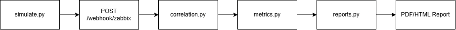

# NOC Incident Management & SLA Reporting Pipeline

> **Catatan Penting:** Proyek ini merupakan laboratorium simulasi pribadi. Seluruh alarm, perangkat (OLT/ONT/IPTV/B2B), pelanggan, dan data insiden bersifat simulasi. Proyek ini tidak terintegrasi dengan infrastruktur milik perusahaan maupun penyedia layanan internet (ISP) mana pun.

## Ringkasan

Proyek ini mensimulasikan alur kerja *Network Operations Center* (NOC) secara menyeluruh, mulai dari penerimaan alarm hingga pelaporan. Fitur utama:

- Menerima alarm dari sistem monitoring melalui webhook.
- Mengorelasikan alarm yang saling berkaitan menjadi satu insiden.
- Menentukan prioritas insiden (P1–P4) berdasarkan aturan yang terdefinisi.
- Mengelola siklus hidup tiket insiden.
- Menghasilkan pesan eskalasi.
- Menghitung metrik SLA (MTTD, MTTR, Availability).
- Menerbitkan laporan dalam format PDF/HTML.

## Alur Data



```
simulate.py → POST /webhook/zabbix → correlation.py → metrics.py → reports.py → Laporan PDF/HTML
```

| Komponen | Fungsi |
|---|---|
| `simulate.py` | Menghasilkan alarm simulasi dan mengirimkannya ke webhook |
| `POST /webhook/zabbix` | Endpoint penerima alarm dari sistem monitoring |
| `correlation.py` | Korelasi alarm menjadi insiden dan penentuan prioritas |
| `metrics.py` | Perhitungan metrik SLA |
| `reports.py` | Pembuatan laporan PDF/HTML |

## Cara Menjalankan

1. Buat virtual environment:
   ```bash
   python -m venv .venv
   ```
2. Aktifkan virtual environment:
   - Windows (PowerShell): `.venv\Scripts\Activate.ps1`
   - Linux/macOS: `source .venv/bin/activate`
3. Pasang dependensi:
   ```bash
   pip install -r requirements.txt
   ```
4. Jalankan server:
   ```bash
   uvicorn app.main:app --reload
   ```
5. Buka dokumentasi API (Swagger UI) di `http://127.0.0.1:8000/docs`.
6. Kirim alarm simulasi (pada terminal baru):
   ```bash
   python simulate.py ont-los
   ```
7. Buat data simulasi untuk periode 28 hari:
   ```bash
   python sample-data/seed.py
   ```
8. Hasilkan laporan:
   ```bash
   python -m app.reports 28 --html
   ```
9. Jalankan pengujian:
   ```bash
   pytest -v
   ```

## Definisi Metrik

| Metrik | Definisi |
|---|---|
| **MTTD** (*Mean Time To Detect*) | Rata-rata selisih `detected_at − fault_started_at` |
| **MTTR** (*Mean Time To Resolve*) | Rata-rata selisih `resolved_at − detected_at` |
| **Availability (%)** | `(Total waktu periode − total downtime P1/P2) / Total waktu periode × 100` |
| **Pelanggaran SLA** | Terjadi apabila Availability (%) berada di bawah `sla_target` |

## Aturan Prioritas

Prioritas dievaluasi secara berurutan dari P1 hingga P4; kriteria pertama yang terpenuhi menentukan prioritas insiden.

| Prioritas | Kriteria |
|---|---|
| **P1** | *Severity* ≥ 5 **atau** jumlah pelanggan terdampak ≥ 5 |
| **P2** | *Severity* ≥ 4 **atau** (layanan B2B dengan *severity* ≥ 3) |
| **P3** | *Severity* ≥ 3 |
| **P4** | Tidak memenuhi kriteria di atas |

## Batasan

- Korelasi alarm menggunakan peta topologi statis (`topology.py`) dan belum memanfaatkan *machine learning*.
- Seluruh data bersifat simulasi dan tidak merepresentasikan data operasional nyata.
- Basis data menggunakan SQLite sehingga hanya sesuai untuk lingkungan lab.
- Belum tersedia mekanisme autentikasi dan otorisasi (login/RBAC).

## Capaian Pembelajaran

- Membangun REST API menggunakan FastAPI dan SQLAlchemy.
- Menerapkan logika *event correlation* untuk mengurangi *alert fatigue*.
- Menghitung metrik SLA (MTTD, MTTR, Availability).
- Mengotomatisasi pembuatan laporan menggunakan Jinja2 dan WeasyPrint.
- Menulis *unit test* menggunakan Pytest.

## Rencana Pengembangan

- Integrasi langsung dengan API Zabbix/Prometheus.
- Notifikasi eskalasi melalui bot Telegram.
- Migrasi basis data ke PostgreSQL.
